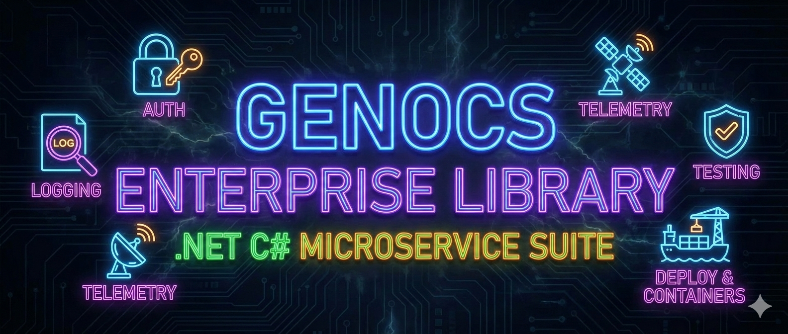

# Genocs.Persistence.CosmosDB



Azure Cosmos DB repository and persistence integration for Genocs applications. Supports `net10.0`, `net9.0`, and `net8.0`.

## Installation

```bash
dotnet add package Genocs.Persistence.CosmosDB
```

The host also needs `Genocs.Core`, because registration extends `IGenocsBuilder`.

## Getting Started

Register the client from configuration, then bind one repository for each container.

```csharp
using Genocs.Core.Builders;
using Genocs.Persistence.CosmosDB.Domain.Entities;
using Genocs.Persistence.CosmosDB.Domain.Repositories;
using Genocs.Persistence.CosmosDB.Extensions;

var builder = WebApplication.CreateBuilder(args);

IGenocsBuilder genocs = builder
    .AddGenocs()
    .AddCosmos()
    .AddCosmosRepository<OrderDocument, Guid>("orders");

genocs.Build();

var app = builder.Build();
app.Run();

public sealed class OrdersService(ICosmosRepository<OrderDocument, Guid> orders)
{
}

public sealed class OrderDocument : ICosmosEntity<Guid>
{
    public Guid Id { get; set; }

    public string PartitionKey { get; set; } = default!;

    public string Status { get; set; } = default!;

    public bool IsTransient() => Id == Guid.Empty;
}
```

Configuration:

```json
{
  "cosmosDb": {
    "connectionString": "AccountEndpoint=https://localhost:8081/;AccountKey=...",
    "database": "orders"
  }
}
```

`AddCosmos()` does nothing when the `cosmosDb` section is missing or when `connectionString` or `database` is empty. It does not throw.

## Container contract

Each repository talks to one existing container. This package does not create the database or the container.

- The container partition key path must be `/partitionKey`.
- `ICosmosEntity<TKey>.PartitionKey` is stored as `partitionKey`.
- `Id` is stored as the Cosmos item `id`.
- `TKey` must be `string` or `Guid`. Other key types are rejected at registration.
- A `Guid` id is written as a dashed string (`D` format). `Guid.Empty` and a blank string id are rejected.

## Repository operations

Inject `ICosmosRepository<TEntity, TKey>`.

| Method | Behavior |
|---|---|
| `GetAsync(id, partitionKey)` | Point read. Returns `null` when the item does not exist. |
| `GetAsync(predicate)` | Cross-partition LINQ query. Returns `null` when nothing matches. Throws `InvalidOperationException` when more than one document matches. |
| `FindAsync(predicate)` | Cross-partition LINQ query. Returns every match, paging through the feed. |
| `AddAsync(entity)` | `CreateItem` in `entity.PartitionKey`. Fails when that id already exists in the partition. |
| `UpdateAsync(entity)` | Full `ReplaceItem` in `entity.PartitionKey`. Fails when the item is missing. |
| `DeleteAsync(id, partitionKey)` | Point delete. |
| `ExistsAsync(id, partitionKey)` | Point read. Returns `false` when the item is missing. |

Updates replace the whole document. There is no patch API, optimistic concurrency, or unit of work.

## Serialization

The registered `CosmosClient` uses System.Text.Json with camelCase property names. Null properties are omitted. Extra JSON properties on existing documents are ignored only when the document type can accept them; the serializer does not add an ignore-extra-elements convention of its own.

## What this package does not do

- It does not create or migrate containers.
- It does not register repositories by scanning assemblies.
- It does not seed data on startup.
- It does not expose sessions, transactional batches, or change feed.
- It does not check an ETag or a version property.

## Support

- Documentation Portal: https://genocs-blog.netlify.app/
- Documentation: https://github.com/Genocs/genocs-library/tree/main/docs
- Repository: https://github.com/Genocs/genocs-library

## Release Notes

- CHANGELOG: https://github.com/Genocs/genocs-library/blob/main/CHANGELOG.md
- Releases: https://github.com/Genocs/genocs-library/releases
