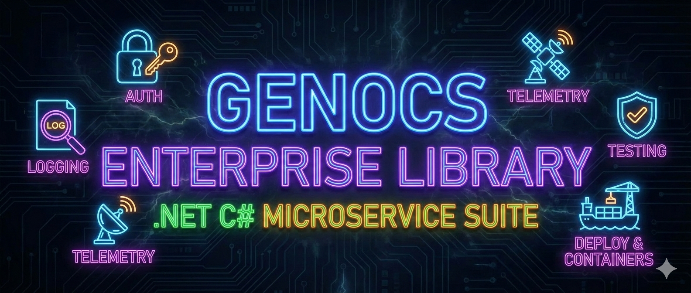

# Genocs.Persistence.MongoDB



MongoDB repository and persistence integration for Genocs applications. Supports `net10.0`, `net9.0`, and `net8.0`.

## Installation

```bash
dotnet add package Genocs.Persistence.MongoDB
```

## Getting Started

Use this package to configure MongoDB repositories and persistence registrations for Genocs services.

Service registration:

```csharp
using Genocs.Persistence.MongoDB.Extensions;

genocs.AddMongoWithRegistration();
```

Configuration example:

```json
{
  "mongoDb": {
    "connectionString": "mongodb://localhost:27017",
    "database": "genocs_db",
    "guidRepresentationMode": "Standard"
  }
}
```

## GUID Representation Strategy

`Genocs.Persistence.MongoDB` now defaults to `GuidRepresentation.Standard` for new deployments.

Available `mongoDb.guidRepresentationMode` values:

- `Standard` (default)
- `CSharpLegacy` (compatibility mode for legacy datasets)

## Migration Guidance (Legacy GUID Data)

If your existing MongoDB data was written using legacy GUID representation:

1. Set `mongoDb.guidRepresentationMode` to `CSharpLegacy` during transition.
2. Validate read/write compatibility in staging against existing documents.
3. Plan and execute GUID normalization/migration to standard representation.
4. Switch `mongoDb.guidRepresentationMode` back to `Standard` once migration is complete.

## Main Entry Points

- `AddMongo`
- `AddMongoWithRegistration`

## Runtime Behavior Notes (April 2026)

- `IMongoDatabaseProvider`, `IMongoSessionFactory`, and repository access paths now share one DI-managed `IMongoClient` composition.
- Startup seeding is guarded per database key (`connectionString|database`), so different databases can seed independently in the same process.
- If seeding fails, the initializer guard key is cleared so a subsequent startup can retry deterministically.

## Optimistic Concurrency

Documents that implement `IVersioned` are protected on both repository paths (`IMongoRepository<TEntity>` and `IMongoBaseRepository<TEntity, TKey>`).

`Version` is the expected token. A replacement is accepted only when the stored version still matches, and the stored value then becomes `Version + 1`. A stale update or a delete of that loaded document throws `OptimisticConcurrencyException` and leaves the previous version on the in-memory object. Inserts keep the version you supply, normally `0`.

`Version` must be a public `long`. The setter may be non-public. Leave it at the value loaded from MongoDB; the repository advances it when the write is accepted. After a conflict, reload the document and retry.

`Delete(id)` and deletes that use a predicate do not check `Version`. Pass the loaded document to `Delete` or `DeleteAsync` when the delete must reject a stale version. Documents that do not implement `IVersioned` stay last-write-wins.

## Encryption Surface Guidance

This package does not currently provide built-in client-side field encryption wiring.

If your application requires encryption-at-rest behavior at the driver layer:

1. Implement encryption composition in application code.
2. Keep the package registration focused on connectivity/repository concerns.
3. Document and validate encryption behavior at host level.

## Support

- Documentation Portal: https://genocs-blog.netlify.app/
- Documentation: https://github.com/Genocs/genocs-library/tree/main/docs
- Repository: https://github.com/Genocs/genocs-library

## Release Notes

- CHANGELOG: https://github.com/Genocs/genocs-library/blob/main/CHANGELOG.md
- Releases: https://github.com/Genocs/genocs-library/releases
